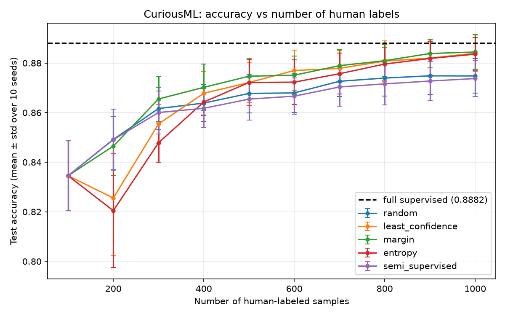

# CuriousML: Reducing Data Labeling Effort Using Active and Semi-Supervised Learning

**Learning More from Fewer Labels**

## Project objective
Labeling data by hand is slow and costly. This project measures how much
labeling effort can be saved when a text classifier chooses which samples
a human should label (active learning) or learns from its own confident
guesses (semi-supervised learning).

## Main research question
How few human-labeled text samples are needed for a classifier to reach
good performance when the model intelligently chooses which samples
should be labeled?

## Setup
- Dataset: AG News (4 classes), balanced subset of 10,000 texts
- Split per seed: 2,000 test (locked), 100 initial labeled, 7,900 pool
- Features: pre-trained Sentence Transformer `all-MiniLM-L6-v2` (384 numbers
  per text, never trained by us)
- Classifier: Logistic Regression, identical for every method
- Labels are added in batches of 100, from 100 up to 1,000
- 10 random seeds (0 to 9); every method uses the same split per seed

## Methods compared
1. Fully supervised (all 8,000 non-test labels): best-case reference
2. Random sampling: baseline
3. Active learning: least confidence, margin, entropy
4. Semi-supervised: confidence-based pseudo-labeling (threshold 0.90)

The test set is never used for training, choosing samples or pseudo-labeling.
It is used only to measure accuracy. The code checks for overlap between sets.

## Results (mean over 10 seeds)
Fully supervised accuracy: 0.8882 (std 0.0058).

| Human labels | Random | Least conf. | Margin | Entropy | Semi-sup. |
|---|---|---|---|---|---|
| 100  | 0.8345 | 0.8345 | 0.8345 | 0.8345 | 0.8345 |
| 300  | 0.8616 | 0.8554 | 0.8655 | 0.8478 | 0.8600 |
| 500  | 0.8678 | 0.8722 | 0.8747 | 0.8722 | 0.8654 |
| 1000 | 0.8748 | 0.8839 | 0.8844 | 0.8836 | 0.8738 |

Labels needed to reach 98% of the fully supervised accuracy (0.8704):
random 700, least confidence 500, margin 500, entropy 500, semi-supervised 800.
Only the three active strategies reached 99% (0.8793), at 800 labels.

Paired check against random (same seed, same split):
- At 1,000 labels all three active strategies were better in 10 of 10 seeds
  (mean gain about +0.009).
- At 300 labels only margin sampling was reliably ahead (8 of 10 seeds).
- Pseudo-labeling was slightly below random at 300 and 500 labels.

## Conclusion
In this setup, uncertainty-based active learning reached a given accuracy with
fewer human labels than random sampling from about 500 labels onward, and was
better in every seed at 1,000 labels. The three active strategies were very
close to each other, so no single one is declared best. Confidence-based
pseudo-labeling did not improve on random sampling here.

## Limitations
One dataset, frozen embeddings with Logistic Regression, batch size 100,
10 seeds. The fully supervised ceiling is about 0.888, so accuracy above 90%
is not expected in this setup. Results may differ for other data or models.

## Technology stack
Python, pandas, numpy, scikit-learn, sentence-transformers, matplotlib,
streamlit, joblib, datasets.

## Folder structure
    app/         Streamlit demo
    notebooks/   Optional notebooks
    report/      Report, slides, demo screenshots
    results/     CSV results and figures
    src/         Reusable code (data, embeddings, classifier, strategies, loops, plots)
    data/ embeddings/ models/   Local only (git-ignored)

## How to run
    python -m venv .venv
    .venv\Scripts\Activate.ps1          (Windows PowerShell)
    pip install -r requirements.txt
    python -m src.data                  # check the dataset and the split
    python -m src.embeddings            # create and save embeddings (a few minutes, once)
    python -m src.experiments           # full supervised, random and active learning
    python -m src.semi_supervised       # pseudo-labeling
    python -m src.plotting              # summary.csv and the graph
    python -m src.significance          # paired check against random
    streamlit run app/streamlit_app.py  # labeling demo

## Streamlit demo
You act as the human labeler. The model picks the text it is least sure about
(margin sampling), you click the correct label, the model retrains and the
accuracy chart updates.